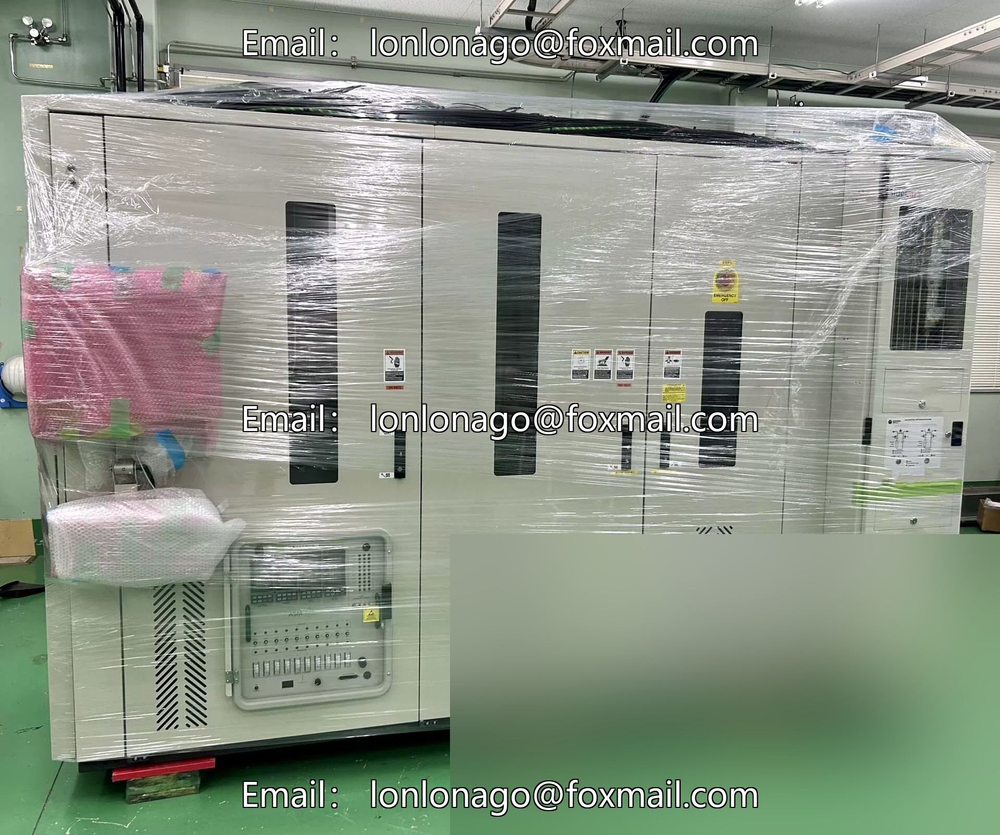
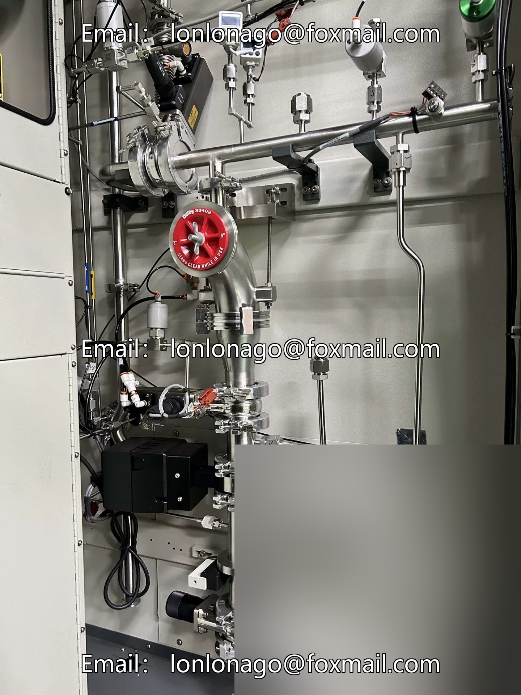
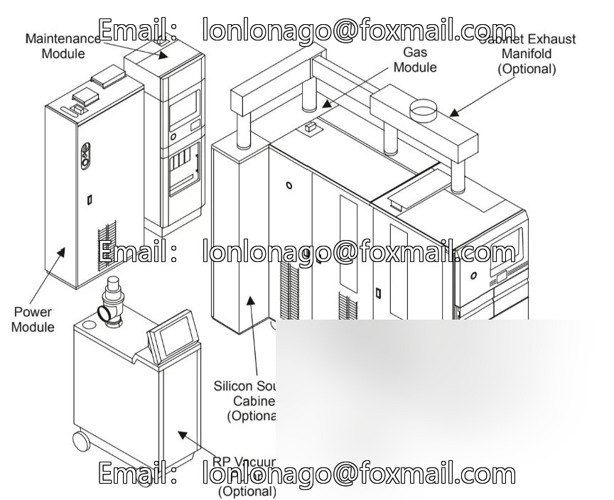
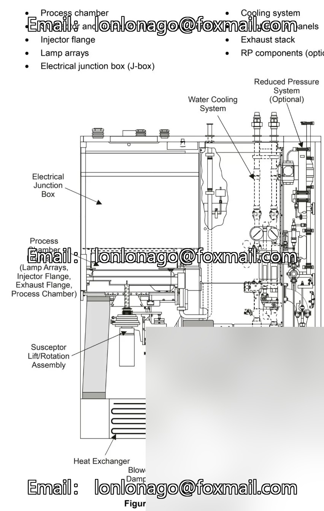
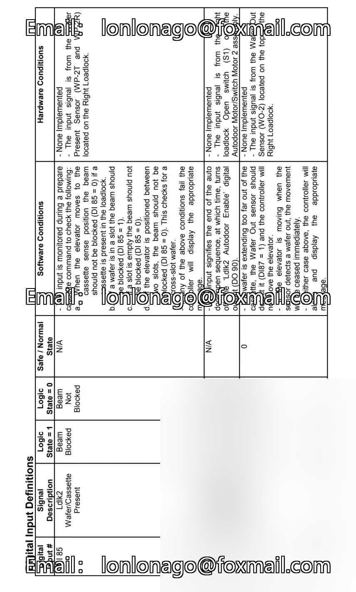
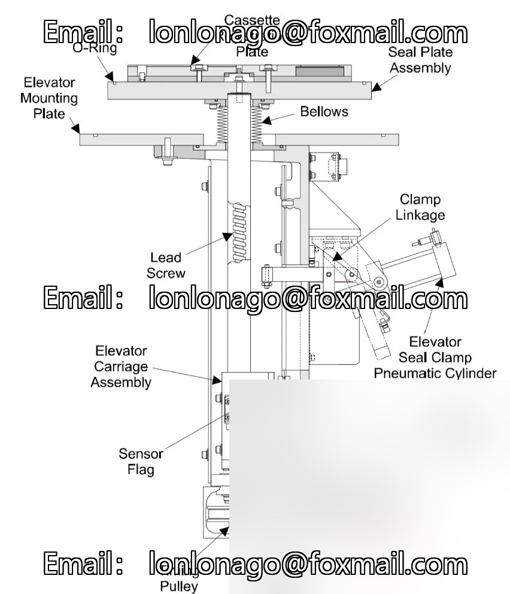
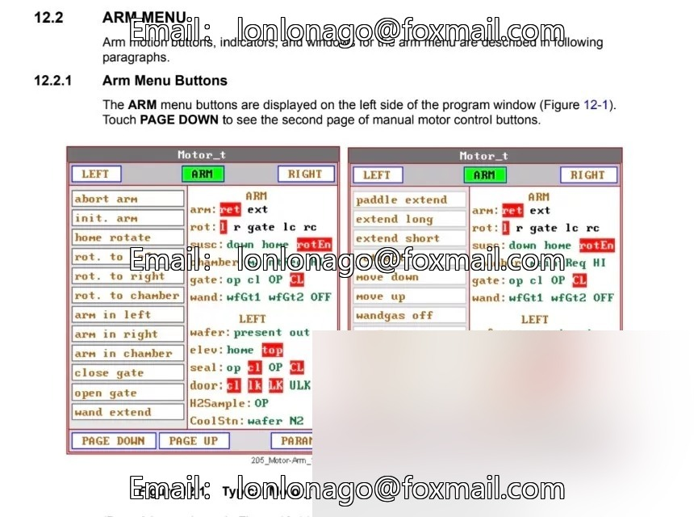
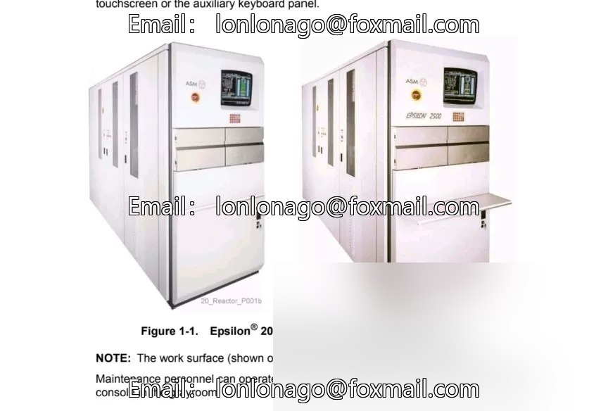

# ASM E2000 O&M Materials Design Materials

## Body

ASM E2000 O&M Data Design Material ASM Epsilon E2000 Operation and Maintenance Technology Manual (O&M)
PDF , 540
​Safety and signal interlocking system (Chapter 3: Safety & Interlocks): Deeply elaborates the safety hazards of toxic/flammable/corrosive special gases (SiH_4, DCS, HCl), hydrogen leakage detection, and safety interlocking logic at the machine hardware level.

Facilities and secondary piping (Hook-up & Facilities): records the dynamic/static original data of machine equipment’s process gas input pressure, large-flow exhaust (Exhaust), cooling water (PCW) load, and power load, which is the core basis for the factory expansion and machine relocation design.
Power and distribution control (Chapter 10: Power Distribution): covers the architectural design of the main circuit breaker, stepped-down transformer, phase sequence monitor (Phase Monitor), and the complete set of power control board cards.

Precision calibration and advanced debugging (Chapter 11: Alignment, Calibration & Test): includes the core temperature control PID tuning, process chamber mechanical alignment, gas panel leak testing, etc.

Hardware major overhaul and part replacement SOP (Chapter 12/13: Remove & Install / PM): Provides official disassembly and maintenance steps for critical consumables and core components such as reaction cavity, lamp array, multi-flange injector, and wafer transfer robot arm.

ASM Epsilon E2000, ASM Epi Manual, Epitaxial Reactor O&M, First Crystal Semiconductor Epitaxial Furnace Manual, Wafer Factory Secondary Equip Configuration Hook-up, Semiconductor Transfer Equip Parameter, Chamber Alignment, PID Value Tune, Lamp Array Replacement, Semiconductor Second-hand Equipment Refurbishment Materials. : upon sale. Those needing direct photography may contact privately.
222-11

The ASM E2000 O&M material design provides content across safety, facilities, power distribution, process calibration and hardware maintenance.

<!-- AI_ENRICHED -->

## Images

## Payment

Here is a pay link on Stripe ( https://buy.stripe.com/3cs8yP7sY87d0vu9AB ). Please contact me lonlonago@foxmail.com after funding $89, and I will send you a complete data files , thank you!

